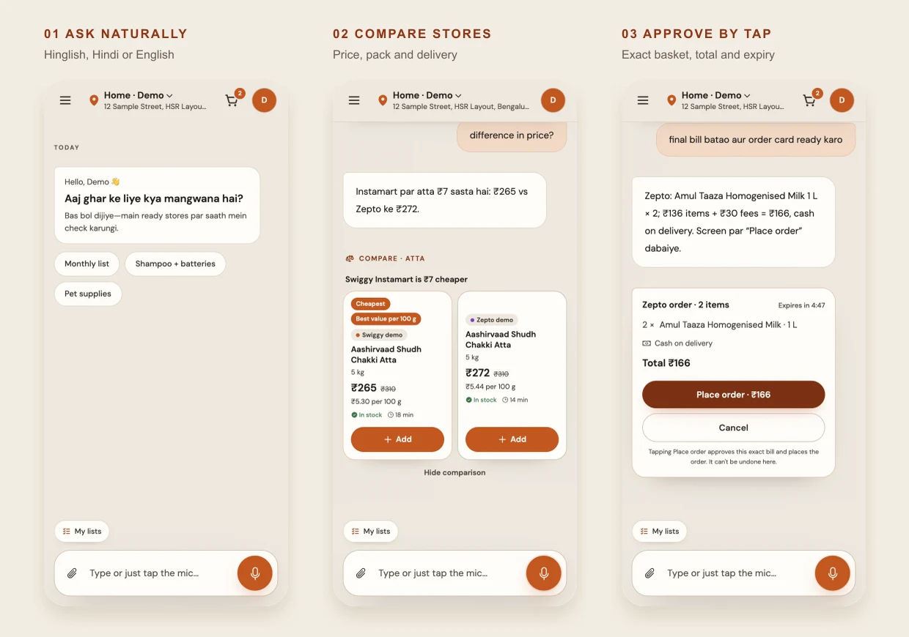
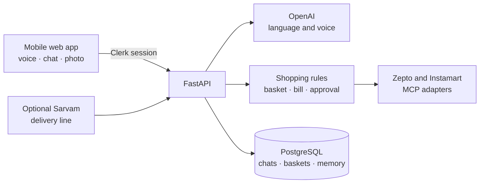

# GharSaathi

<p align="center">
  
</p>

<p align="center"><strong>Ghar ka saaman? Bol do.</strong><br>
Shop for household essentials by speaking in Hindi, English, or Hinglish.</p>

<p align="center">
  <a href="https://www.loom.com/share/ce3eb455ab484b059d11ee0382ed2d65">Watch the 4-minute demo</a> ·
  <a href="#run-the-demo">Run the demo</a> ·
  <a href="docs/ARCHITECTURE.md">Read the architecture</a>
</p>

GharSaathi is a voice-first shopping assistant for Indian households. Tell it what you need and it checks connected Zepto and Swiggy Instamart catalogues, compares the available options, and prepares your basket.

Before an order is placed, GharSaathi shows the items, fees, delivery address, and final payable amount. You place the order by tapping **Place order** on that exact bill.

## Features

- Understand shopping requests in Hindi, English, and Roman-script Hinglish
- Accept voice, typed messages, and product photos
- Search Zepto and Swiggy Instamart together
- Compare price, pack size, availability, and delivery time
- Build separate baskets for each store
- Save shopping lists for later
- Remember preferences that you choose to save
- Show order status and provider-reported delivery estimates
- Give an approved delivery rider your saved directions through the optional delivery line

## Product tour



*These screens use the sample catalogue. The prices and delivery times are demo data.*

## How an order works

1. Say or type what you need.
2. GharSaathi searches the stores that are ready for your selected address.
3. Choose a product, or ask GharSaathi to prepare the basket.
4. Review the exact items, fees, address, payment method, and total.
5. Tap **Place order** on the final order card.

A spoken or typed “yes” does not place an order. The order card expires after five minutes, and any change to the basket creates a new bill.

## Household memory

GharSaathi can remember details such as:

- preferred brands
- usual pack sizes and quantities
- dietary preferences
- products to avoid
- corrections such as “not that one, I buy the 1 litre pack”

Memory follows a reviewable flow:

1. The user states a preference in chat or during setup.
2. The memory service creates a proposal using evidence from that exact message.
3. The user chooses **Confirm & use** or rejects it.
4. A confirmed memory is stored under that person’s account in PostgreSQL.
5. Relevant memories are retrieved before a broad product search and applied to ranking or follow-up questions.

Each memory records its source, status, and allowed purpose. A permission must be active before the memory can personalize a search. The **What GharSaathi knows** screen shows every saved record and lets the user correct or delete it.

Purchase history is handled separately. Import requires explicit consent, remains read-only, and is used to suggest a previously purchased item. It is never treated as a household inventory or proof that something needs replenishing.

The extraction layer uses a structured OpenAI response when an API key is available. A small local ruleset handles high-confidence brand, size, quantity, dietary, and avoidance statements when the model is unavailable. Both paths create proposals; confirmation is what makes a memory usable.

Implementation details and API contracts are in [Person-scoped memory](docs/DEVELOPER_GUIDE.md#person-scoped-memory).

## Run the demo

Demo mode uses a sample address, sample products, and deterministic fees. It does not contact Zepto or Swiggy, change a real cart, take payment, or place an order.

### Requirements

- macOS or Linux
- Python 3.11+ and [uv](https://docs.astral.sh/uv/)
- Node.js 20+ and npm
- PostgreSQL 15+
- a Clerk development instance
- an OpenAI API key for chat, voice, and photo understanding

The launcher currently checks for an OpenAI key. The sample catalogue and basket calculations themselves do not call OpenAI.

### Setup

```bash
git clone https://github.com/CodeWithMoin/gharsaathi.git
cd gharsaathi
cp .env.example .env
cp frontend/.env.local.example frontend/.env.local
```

Create a PostgreSQL database and set `DATABASE_URL` in `.env` to its `postgresql+asyncpg://…` connection string.

Generate an encryption key:

```bash
python3 -c "import base64,secrets; print(base64.urlsafe_b64encode(secrets.token_bytes(32)).decode())"
```

Add the result as `APP_ENCRYPTION_KEY` in `.env`.

Then configure:

- `OPENAI_API_KEY` and `CLERK_SECRET_KEY` in `.env`
- `NEXT_PUBLIC_CLERK_PUBLISHABLE_KEY` and `CLERK_SECRET_KEY` in `frontend/.env.local`

Use keys from the same Clerk development instance. Keep the example `http://localhost:3003` origins unless you also update the frontend URL, CORS origins, and Clerk authorized parties. The environment files are ignored by Git.

Start the app:

```bash
make start-demo
make status
```

Open **http://localhost:3003**. The API runs at `http://127.0.0.1:8000`, with health at `/health` and interactive docs at `/docs`.

For a Clerk test login, sign up with a fresh address containing `+clerk_test` and use verification code `424242`.

Try:

```text
2 Amul doodh order kar do
atta search karo
difference in price?
```

The demo shows the full order flow and blocks the real checkout when **Place order** is tapped.

Useful commands:

```bash
make logs          # follow frontend and backend logs
make stop          # stop the app
make doctor        # check local readiness
make check         # tests, lint, and type-check
make check-full    # checks plus a production frontend build
```

See [AGENTS.md](AGENTS.md) for the complete reviewer setup, including Linux PostgreSQL commands and troubleshooting. The [developer guide](docs/DEVELOPER_GUIDE.md) covers provider OAuth, voice diagnostics, notifications, and advanced local workflows.

## How it is built



| Area | Technology |
| --- | --- |
| Web app | Next.js 15, React 19, TypeScript, Tailwind |
| API | FastAPI, Pydantic, SQLAlchemy |
| Data | PostgreSQL |
| Voice and language | OpenAI Realtime and Responses APIs |
| Commerce | Zepto MCP and Swiggy Instamart MCP |
| Delivery line | Sarvam inbound voice agent |

The backend handles product data, prices, fees, permissions, baskets, approvals, and order state. Money calculations use deterministic code. Provider credentials stay on the server and are encrypted at rest for local development.

More detail:

- [Architecture](docs/ARCHITECTURE.md)
- [Capability matrix](docs/CAPABILITIES.md)
- [Failure modes](docs/FAILURE_MODES.md)
- [Demo video and walkthrough](VIDEO.md)

## Safety rules

- Every order requires a tap on the final order card.
- Approval applies only to the items, amount, address, and payment method shown.
- Basket or price changes require a new bill.
- GharSaathi never asks for a password, OTP, UPI PIN, card number, or CVV.
- Unknown checkout outcomes are checked against provider history before another attempt is allowed.
- Saved preferences can be viewed, corrected, or deleted.
- Purchase history is never treated as proof that an item has run out at home.

## Current scope

Live mode connects real provider accounts and can change a real cart. Use it only with your own accounts.

The current Zepto connection storage is intended for supervised, local, single-user use. A multi-user deployment needs a separate encrypted provider connection for every user.

Catalogue data, prices, delivery times, OAuth access, and order tracking depend on the connected providers. The Sarvam delivery line also needs an owner-configured phone setup and public backend endpoint.

## Tests

```bash
make test
make check
make check-full
```

Automated tests use mocked provider responses and do not place real orders.
