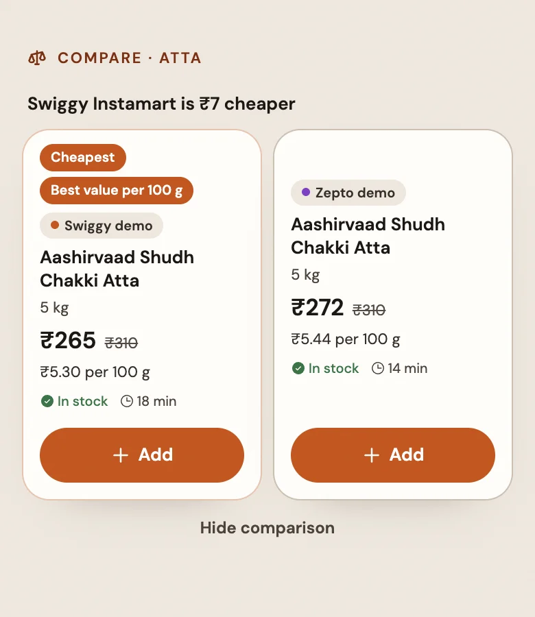
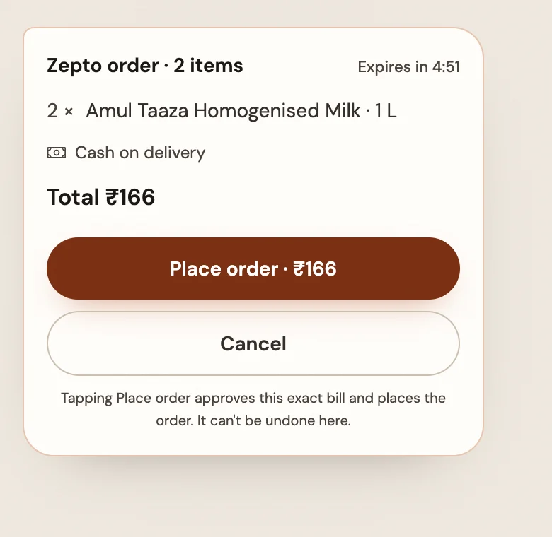
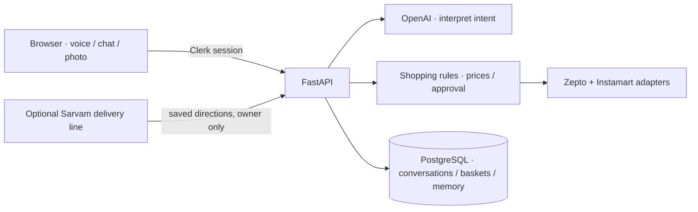

# GharSaathi

<p align="center">
  
</p>

<p align="center"><strong>Ghar ka saaman? Bol do.</strong><br>
A voice-first shopping assistant for Indian households. Ask in Hindi, English, or Hinglish; compare what nearby stores offer; and decide what to buy yourself.</p>

<p align="center">
  <a href="https://www.loom.com/share/ce3eb455ab484b059d11ee0382ed2d65">Watch the 4-minute demo</a> ·
  <a href="#run-the-demo">Run it locally</a> ·
  <a href="docs/ARCHITECTURE.md">How it works</a>
</p>

GharSaathi searches connected Zepto and Swiggy Instamart catalogues, helps build a basket, shows the exact bill, and keeps the conversation in one place. It remembers preferences you choose to save. When a real order is on its way, it can show tracking updates; an optional, owner-configured delivery line can guide a rider using saved directions.

**Nothing is purchased because an AI said "yes."** A person must tap **Place order** on a short-lived card bound to the exact basket, amount, and address. Demo mode never calls a commerce provider or places an order.

## A look inside

<table>
  <tr>
    <th>Compare stores</th>
    <th>Approve the exact order</th>
  </tr>
  <tr>
    <td></td>
    <td></td>
  </tr>
</table>

*Screenshots are from the sample catalogue. Prices and delivery times shown here are demo data, not live offers.*

### What you can do

- **Talk or type naturally.** Ask for milk in Hinglish, switch products mid-sentence, or attach a photo of a pack. Voice, typed chat, and photo understanding use OpenAI; the basket and prices do not depend on model arithmetic.
- **Shop across stores.** Search products, compare availability, pack size, price, and delivery estimates, then keep separate baskets and bills for each store.
- **Keep your household context.** See, correct, or delete saved preferences; reuse shopping lists. Past purchases are never treated as proof that you need more.
- **Review before ordering.** A live Zepto checkout requires an exact bill, explicit approval, and a separate tap on the final order card. An unknown provider outcome is checked read-only, never blindly retried.
- **Follow a delivery.** Track provider-reported status and ETA. The optional delivery line uses saved address directions and never asks for an OTP, PIN, or payment details.

## Run the demo

This is the safest way to explore the app: sample catalogue and address, deterministic fees, **no Zepto/Swiggy account and no real cart, checkout, payment, or order calls**.

**You need:** macOS or Linux, Python 3.11+ with [uv](https://docs.astral.sh/uv/), Node.js 20+ with npm, PostgreSQL 15+, a Clerk *development* instance, and an OpenAI API key for chat/voice/photo. The sample catalogue and basket do not call OpenAI, but the `make start-demo` launcher checks that a key is configured. On macOS, it can start a local Homebrew PostgreSQL instance; on Linux, start PostgreSQL yourself.

```bash
git clone https://github.com/CodeWithMoin/gharsaathi.git
cd gharsaathi
cp .env.example .env
cp frontend/.env.local.example frontend/.env.local
```

Create a PostgreSQL database and user, then set `DATABASE_URL` in `.env` to a working `postgresql+asyncpg://…` URL. Generate an encryption key with the command below and put its output in `APP_ENCRYPTION_KEY` in `.env`:

```bash
python3 -c "import base64,secrets; print(base64.urlsafe_b64encode(secrets.token_bytes(32)).decode())"
```

Set `OPENAI_API_KEY` and `CLERK_SECRET_KEY` in `.env`. Set `NEXT_PUBLIC_CLERK_PUBLISHABLE_KEY` and `CLERK_SECRET_KEY` in `frontend/.env.local` using keys from the **same Clerk development instance**. Keep the example's `http://localhost:3003` origins (or update the frontend URL, CORS origins, and authorized parties together if you change ports). Never commit either env file.

```bash
make start-demo    # installs missing frontend dependencies, migrates the DB, starts both servers
make status
```

Open **http://localhost:3003**. The backend is at `http://127.0.0.1:8000` (`/health` and `/docs`). `make stop` shuts down the app. For a test login with development Clerk keys, sign up using a fresh `+clerk_test` email and code `424242`. No email is sent.

Try `2 Amul doodh order kar do`, `atta search karo`, and `difference in price?`. The demo order card will **refuse** a real checkout on tap. That refusal is expected.

The full setup, including Linux commands, provider OAuth callbacks, and troubleshooting, is in [AGENTS.md](AGENTS.md) and the [developer guide](docs/DEVELOPER_GUIDE.md).

## Under the hood



The model can understand a request and suggest a tool call. The backend validates permissions, provider results, arithmetic, and order state. Provider tokens stay server-side. See [the architecture](docs/ARCHITECTURE.md), [capability matrix](docs/CAPABILITIES.md), and [failure modes](docs/FAILURE_MODES.md) for the deeper contracts.

| Part | Built with |
| --- | --- |
| Web | Next.js 15, React 19, TypeScript, Tailwind |
| API | FastAPI, Pydantic, SQLAlchemy |
| Data | PostgreSQL; encrypted local provider connections |
| Voice and understanding | OpenAI Realtime + backend-delegated shopping tools |
| Commerce | Official Swiggy Instamart and Zepto MCP integrations |
| Delivery assistance | Optional Sarvam inbound voice agent |

## Safety and current scope

- **Demo is offline from stores.** Live mode requires your own provider connections and can touch a real basket or place an order after the final tap; use it only when you mean to.
- **Live Zepto is for supervised, local, single-user use.** Provider connection files are encrypted but deployment-global. Multi-user production needs per-user provider credentials and sessions.
- **The delivery line is opt-in and owner-configured.** It does not automatically work for everyone who clones the repo.
- **Provider data is conditional.** Catalogues, addresses, prices, delivery estimates, OAuth access, and call routing depend on external services. The README screenshots are demo data.

## Verify and explore

```bash
make test         # backend + frontend tests; provider calls mocked
make check        # tests, lint, type-check
make check-full   # above + production frontend build
```

Start in [the developer guide](docs/DEVELOPER_GUIDE.md) for the exact OAuth setup and advanced workflows. The [demo video](VIDEO.md) walks through shopping, approval, tracking, and the delivery line.
