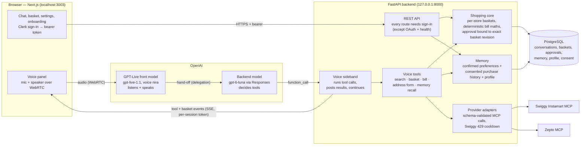

# GharSaathi architecture

How a request flows through the system, and every decision taken before the
assistant answers. Status markers: **live** = merged in `main`;
**in progress** = being built on the named branch.

## Components

## One voice turn: every decision before she answers

### Who decides what

| # | Decision | Decided by | Enforced in code? |
|---|---|---|---|
| D1 | Answer directly vs hand off to the backend model | GPT-Live (instructions) | No — but voice has no order/approve tool, so it can't act wrongly |
| D2 | Is the request clear? Ask for more context? | Backend model (instructions) | No — rules: at most one question, never re-ask what was said |
| D3 | Check memory first | Backend model calls `recall_household_preferences` | **Today: no** (model may skip it — the Diet Coke miss). **In progress:** memory summary at session start + memory-annotated search results, so remembered items are always in front of the model |
| D4 | Add vs ask which variant/store | Backend model (instructions + few-shot examples) | Partly — store ambiguity on bills returns `needs_store` from code |
| D5 | Call another tool or answer | Backend model | Hard cap: 6 rounds / 4 searches per turn (code, `sideband.py`) |

### Deterministic checks (code, every call)

| Check | Location | Prevents |
|---|---|---|
| Strict JSON schema on every tool argument | `backend/app/voice/*_tools.py`, `tools.py` | Malformed or extra arguments |
| Not-a-product guard | `backend/app/commerce/query_guard.py` | Searching chit-chat |
| Store connected + delivery address selected | `tools.py`, `basket_tools.py` | Search/add without a store (`not_connected`) |
| Opaque `option_id` → stored search result | search → basket | Invented products or prices |
| Which store for the bill | `basket_tools.py` | Guessing a store (`needs_store`) |
| Consent + household scoping | `backend/app/memory/recall.py` | Using history without consent or another user's data |
| Swiggy 429 cooldown | `backend/app/commerce/swiggy/client.py` | Hammering a rate-limited account |
| Bill arithmetic in paise | `backend/app/shopping/basket.py` | Model-generated maths |
| Approval bound to basket revision, conditional DB writes | `backend/app/shopping/approval.py`, `checkout.py` | Approving/ordering a basket the user didn't see |
| Accepted current terms for consequential actions | `backend/app/legal_consent.py` dependency | Acting before consent |
| No voice tool can approve or place orders | tool list | Spoken "yes" becoming an order |

## Context size per turn (prompt 1.8.0, o200k tokens)

What each model sees before the conversation itself. Measured with
`tiktoken` `o200k_base`; re-measure after prompt changes.

| Part | Front model (GPT-Live) | Backend model (gpt-6-luna) |
|---|---|---|
| Instructions | **2,643** (10,382 chars) | **2,958** (11,225 chars) |
| …of which few-shot examples | 589 | 1,327 (45%) |
| Session profile block (name, address form) | ~60 | ~60 |
| Tool definitions (7 tools) | — | **1,450** (`open_address_form` alone 468) |
| Household memory summary | — | ⟨in progress⟩ capped at ~8 items |
| One search result | — | 320 (2 options) – 750 (6 options) |
| **Fixed overhead before conversation** | **~2.7k** | **~4.5k**, plus ~0.3–0.75k per search round |

Largest backend sections: examples 1,327 · household memory 325 · basket 267 ·
task 256 · decisive selection 227 · return the result 214. Largest live sections:
examples 589 · decisive replies 499 · delegation 336 · language 312.

## Chat context at session start

Each voice session (and, via the same builder, each typed chat turn) starts with
the verified user's own saved chats, read server-side by
`ConversationContextLoader.load(user_id)` in `backend/app/conversations/context.py`.
Nothing is taken from the browser.

| Part | Source | Cap (o200k) |
|---|---|---|
| Current chat summary | `conversations.summary`, written in the background | 110 |
| Last 6 turns, verbatim | saved messages | 170 |
| On screen: results per item; each store's basket; its latest pending/approved bill (item total, payable, store-confirmed offers, expiry), however it was opened | saved `result_groups` + basket/approval tables (`shopping_approvals.quote`) | 140 |
| Previous chats (≤3, last 30 days): summary or first request, items searched, furthest basket step per store | archived conversations | 110 |

The whole block is ≤ ~600 tokens (measured in `tests/unit/test_conversation_context.py`).
GPT-Live gets the turns as `session.input` startup history
([docs](https://developers.openai.com/api/docs/guides/live-conversations#seed-a-session-with-prior-conversation))
and the rest in its instructions. The backend model gets the whole block in its
instructions. All of it is quoted as untrusted data. Prices, baskets, bills and
orders come only from saved state. Voice `view_basket` also reads the persisted
bill (`Approval.quote`) when the session did not request it, e.g. after the
on-screen "Get final bill" button; it never re-quotes. "Order confirmed" appears only when a chat's
saved timeline reached the `ordered` stage.

Rolling summaries (`backend/app/conversations/summarizer.py`) run off the request
path. They start after a save once 6 new turns have built up, and when a chat is
archived (New chat or opening another chat). The model is set by
`CONVERSATION_SUMMARY_MODEL` (default `gpt-6-luna`), with strict JSON output and a
200-token output cap. A summary records only what the user wanted, preferences
they stated, and open items; prices are stripped. Chats without messages are
never summarised. When there is no summary yet, the deterministic description is
used.

## Typed chat (today)

Typed text does **not** go through either model: `frontend/app/page.tsx` sends it
straight to `/api/swiggy/search/personalized` and `/api/zepto/search`. So D1–D5,
memory and clarifying questions only apply to voice. Routing typed chat through the
same backend model is the top queued item.

## Where to look

- Feature × surface matrix: [`CAPABILITIES.md`](CAPABILITIES.md)
- Test layers and how to run them: [`TESTING.md`](TESTING.md)
- Opt-in real-provider smoke tests: [`LIVE_SMOKE.md`](LIVE_SMOKE.md)
- Voice turn-taking modes: [`voice-turn-taking.md`](voice-turn-taking.md)
