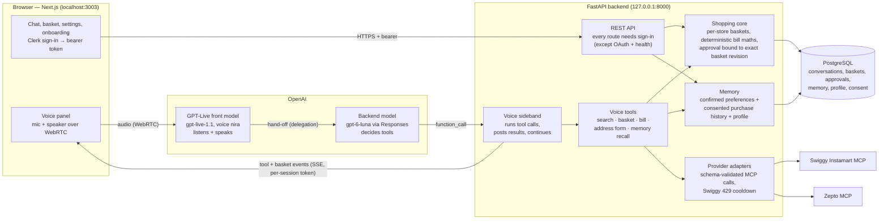
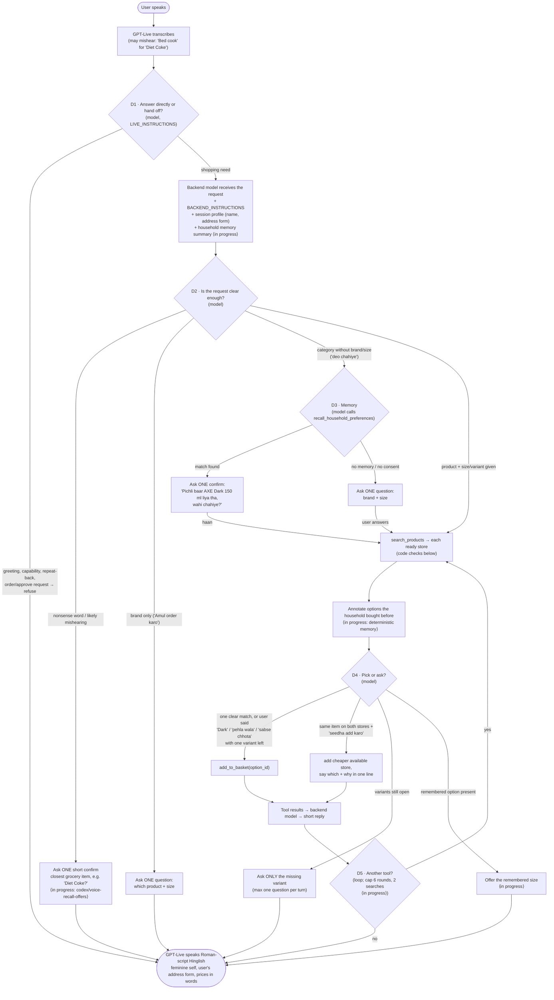
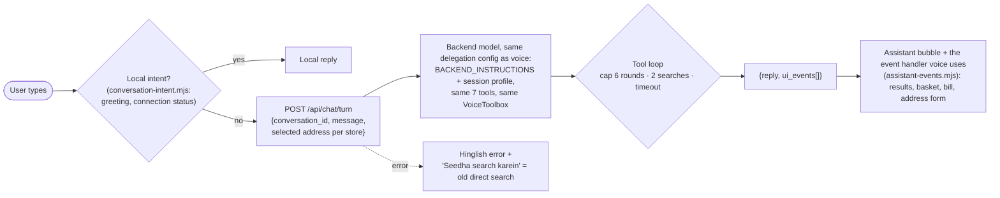

# GharSaathi architecture

How a request flows through the system, and every decision taken before the
assistant answers. Status markers: **live** = merged in `main`;
**in progress** = being built on the named branch.

## Components

## One voice turn: every decision before she answers

### Who decides what

| # | Decision | Decided by | Enforced in code? |
|---|---|---|---|
| D1 | Answer directly vs hand off to the backend model | GPT-Live (instructions) | No — but voice has no order/approve tool, so it can't act wrongly |
| D2 | Is the request clear? Ask for more context? | Backend model (instructions) | No — rules: at most one question, never re-ask what was said |
| D3 | Check memory first | Backend model calls `recall_household_preferences` | **Today: no** (model may skip it — the Diet Coke miss). **In progress:** memory summary at session start + memory-annotated search results, so remembered items are always in front of the model |
| D4 | Add vs ask which variant/store | Backend model (instructions + few-shot examples) | Partly — store ambiguity on bills returns `needs_store` from code |
| D5 | Call another tool or answer | Backend model | Typed chat: yes, hard cap of 6 rounds / 2 searches per turn (`app/chat/service.py`). Voice: **in progress** |

### Deterministic checks (code, every call)

| Check | Location | Prevents |
|---|---|---|
| Strict JSON schema on every tool argument | `backend/app/voice/*_tools.py`, `tools.py` | Malformed or extra arguments |
| Not-a-product guard | `backend/app/commerce/query_guard.py` | Searching chit-chat |
| Store connected + delivery address selected | `tools.py`, `basket_tools.py` | Search/add without a store (`not_connected`) |
| Opaque `option_id` → stored search result | search → basket | Invented products or prices |
| Which store for the bill | `basket_tools.py` | Guessing a store (`needs_store`) |
| Consent + household scoping | `backend/app/memory/recall.py` | Using history without consent or another user's data |
| Swiggy 429 cooldown | `backend/app/commerce/swiggy/client.py` | Hammering a rate-limited account |
| Bill arithmetic in paise | `backend/app/shopping/basket.py` | Model-generated maths |
| Approval bound to basket revision, conditional DB writes | `backend/app/shopping/approval.py`, `checkout.py` | Approving/ordering a basket the user didn't see |
| Accepted current terms for consequential actions | `backend/app/legal_consent.py` dependency | Acting before consent |
| No voice tool can approve or place orders | tool list | Spoken "yes" becoming an order |

## Context size per turn (prompt 1.8.0, o200k tokens)

What each model sees before the conversation itself. Measured with
`tiktoken` `o200k_base`; re-measure after prompt changes.

| Part | Front model (GPT-Live) | Backend model (gpt-6-luna) |
|---|---|---|
| Instructions | **2,643** (10,382 chars) | **2,958** (11,225 chars) |
| …of which few-shot examples | 589 | 1,327 (45%) |
| Session profile block (name, address form) | ~60 | ~60 |
| Tool definitions (7 tools) | — | **1,450** (`open_address_form` alone 468) |
| Household memory summary | — | ⟨in progress⟩ capped at ~8 items |
| One search result | — | 320 (2 options) – 750 (6 options) |
| **Fixed overhead before conversation** | **~2.7k** | **~4.5k**, plus ~0.3–0.75k per search round |

Largest backend sections: examples 1,327 · household memory 325 · basket 267 ·
task 256 · decisive selection 227 · return the result 214. Largest live sections:
examples 589 · decisive replies 499 · delegation 336 · language 312.

## Typed chat

Typed text goes through the same backend model as voice (branch
`codex/typed-chat-assistant`):

- **Same decisions.** D2–D5 above apply unchanged: the request uses
  `build_session_config(...)["delegation"]["responses"]`, so model, instructions,
  profile block, tool definitions and `tool_choice` are the voice ones. There is no
  typed-only prompt. D1 does not exist for typed text (there is no front model).
- **Context per turn.** The last 12 messages of the user's own conversation (at most
  about 6,000 characters), plus this server's last turns if the browser has not saved
  them yet, plus the last 2 search results of this chat as a developer message, so
  "Dark" or "haan wahi" can add an `option_id` the user already saw.
- **Per-conversation state.** `backend/app/chat/service.py` keeps one `VoiceToolbox`
  per (verified user, conversation) in memory (200 sessions, 1 h idle), with turns
  serialised by a lock. A different selected address rebuilds it. After a backend
  restart the earlier `option_id`s are gone and the model searches again.
- **Hard caps (code).** 6 tool rounds, then one forced text answer
  (`tool_choice: "none"`); a third `search_products` in one turn is refused without
  running; a tool name outside the definitions is refused; per-turn timeout
  `CHAT_TURN_TIMEOUT_SECONDS` (default 60 s).
- **Checks.** Clerk identity and accepted current terms on the route (like
  `POST /api/voice/session`). Every deterministic check in the table above runs,
  because the tools are the same. Logs carry the outcome, rounds, tool names and
  latency only, never message text.
- **Persistence.** The browser appends the typed message and the reply to the open
  conversation and saves it with `PUT /api/conversations/current`, exactly like
  voice transcripts.
- **Known gap.** The backend prompt is written for speech, so typed replies also
  spell prices in words ("ek sau ninyanve rupaye").

## Where to look

- Feature × surface matrix: [`CAPABILITIES.md`](CAPABILITIES.md)
- Test layers and how to run them: [`TESTING.md`](TESTING.md)
- Opt-in real-provider smoke tests: [`LIVE_SMOKE.md`](LIVE_SMOKE.md)
- Voice turn-taking modes: [`voice-turn-taking.md`](voice-turn-taking.md)
