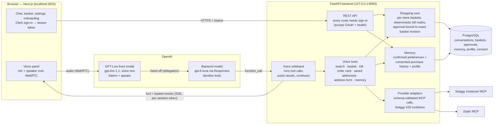
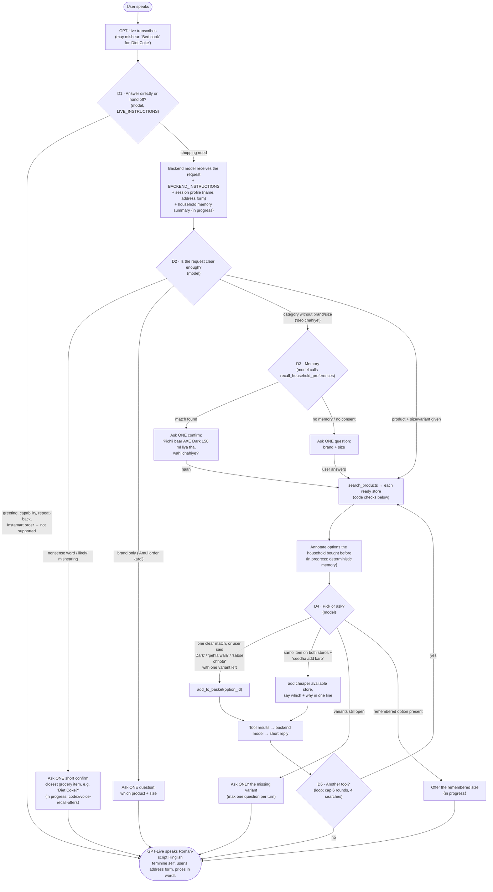
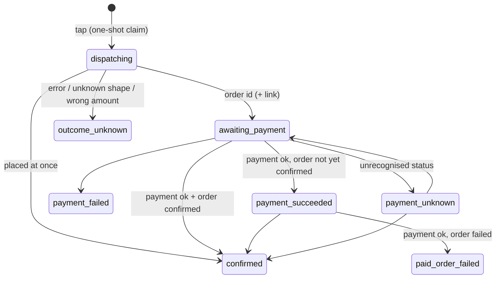
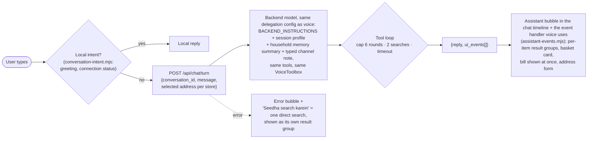
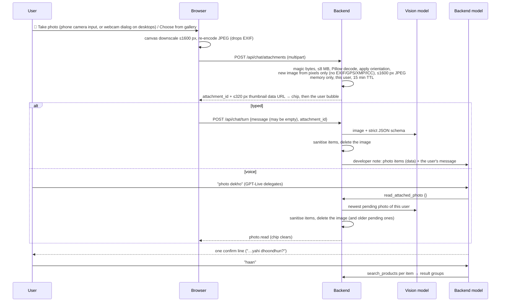

# GharSaathi architecture

How a request flows through the system, and every decision taken before the
assistant answers. Status markers: **live** = merged in `main`;
**in progress** = being built on the named branch.

## Components



## One voice turn: every decision before she answers



### Who decides what

| # | Decision | Decided by | Enforced in code? |
|---|---|---|---|
| D1 | Answer directly vs hand off to the backend model | GPT-Live (instructions) | No — and no answer can order: the only order path is the user's tap on the order card |
| D2 | Is the request clear? Ask for more context? | Backend model (instructions) | No — rules: at most one question, never re-ask what was said |
| D3 | Check memory first | Backend model calls `recall_household_preferences` | **Today: no** (model may skip it — the Diet Coke miss). **In progress:** memory summary at session start + memory-annotated search results, so remembered items are always in front of the model |
| D4 | Add vs ask which variant/store | Backend model (instructions + few-shot examples) | Partly — store ambiguity on bills returns `needs_store` from code |
| D5 | Call another tool or answer | Backend model | Hard cap in code: voice 6 rounds / 4 searches per turn (`sideband.py`); typed chat 6 rounds / 2 searches per turn (`app/chat/service.py`) |
| D6 | Remember a preference stated in passing (tier 1) | Backend model calls `remember_preference` / `update_preference` with `mode: "stated"` | **Yes:** code saves only with habit/rule words (`hamesha`, `kabhi nahi`, `sirf`, `mat … karna`) and refuses one-off words (`is baar`); a stated update must match a remembered item. Saved active at once; reply acknowledges with undo; `forget_preference` within 24 h restores what it replaced |
| D7 | Remember on request ("yaad rakhna…") | Backend model: `remember_preference` `mode: "explicit"` → read-back → `confirm_memory` | **Yes:** stays a pending proposal until `confirm_memory(confirm)`; forget-all needs a token issued in the same session |
| D8 | Suggest a preference from repeated choices (tier 2) | Code: basket adds are recorded; after a conversation save/archive `choice_signals.propose_from_choices` creates a pending proposal (same brand+pack in ≥3 conversations, or the same store every time both offered it) | **Yes:** never active without a yes; offered at most once per session (attached to a matching `add_to_basket` result); rejected/deleted suggestions never return |
| D9 | Apply saved rules to search | Code (`memory/household_rules.py` in `search_products`) | **Yes:** `avoid_store` skips that store's search (and an earlier option from it cannot be added), `avoid_product`/`avoid_brand` hide options unless the query asks for them (then `avoided: true`), `prefer_*` adds `preferred: true` (separate from `remembered`) |
| D10 | Prepare an order card | Backend model calls `prepare_order` on an explicit order request | **Yes, for the order itself:** the tool only shows the card; only the user's tap on **Place order** approves and orders, and code re-checks the bound confirmation first. Calling it at the wrong time can only show a card |
| D11 | Answer "where is my order?" | Backend model calls `get_order_status` / `list_recent_orders` | **Yes:** read-only tools scoped to the verified household; status and ETA come only from the provider; cancelling is not possible (no tool) |

### Deterministic checks (code, every call)

| Check | Location | Prevents |
|---|---|---|
| Strict JSON schema on every tool argument | `backend/app/voice/*_tools.py`, `tools.py` | Malformed or extra arguments |
| Not-a-product guard | `backend/app/commerce/query_guard.py` | Searching chit-chat |
| Store connected + delivery address selected | `tools.py`, `basket_tools.py` | Search/add without a store (`not_connected`) |
| Opaque `option_id` → stored search result | search → basket | Invented products or prices |
| Which store for the bill | `basket_tools.py` | Guessing a store (`needs_store`) |
| Consent + household scoping | `backend/app/memory/recall.py` | Using history without consent or another user's data |
| Preference memory policy: structured kinds, length caps, sensitive categories (health, religion/caste, finances, gender/sexuality, age, family details) refused | `backend/app/memory/household.py`, `household_service.py` | Storing free-text instructions or sensitive traits, in every tier and from the Settings edit route |
| Preference consent (Settings switch) before any write or suggestion | `backend/app/memory/household_service.py` | Remembering when memory is off |
| Swiggy 429 cooldown | `backend/app/commerce/swiggy/client.py` | Hammering a rate-limited account |
| Bill arithmetic in paise | `backend/app/shopping/basket.py` | Model-generated maths |
| Approval bound to basket revision, conditional DB writes | `backend/app/shopping/approval.py`, `checkout.py` | Approving/ordering a basket the user didn't see |
| Accepted current terms for consequential actions | `backend/app/legal_consent.py` dependency | Acting before consent |
| No voice/typed tool can approve or place orders; `prepare_order` only shows the order card | `backend/app/voice/order_tools.py` | Spoken or typed "yes" becoming an order |
| Order status tools read only this household's monitors; refresh obeys the provider interval; no cancel or order call exists | `backend/app/voice/order_status_tools.py`, `backend/app/tracking/service.py` | Another household's order, provider hammering, guessed status, cancellation by voice |
| Order card tap: confirmation belongs to this user, is open (single-use, not cancelled/replaced), unexpired (5 min, capped by the bill), and the basket revision, address, approval, approval fingerprint, quote digest and payable are unchanged; Zepto only; accepted terms | `backend/app/shopping/order_confirmation.py`, `POST /api/orders/confirm` | Ordering a stale, edited, replayed, cancelled or someone else's bill |
| Tap runs the existing approve + COD checkout: idempotency key `order-confirmation:<id>`, durable one-shot claim per approval, fresh re-quote must match, outcome-unknown never retried | `backend/app/shopping/checkout.py` | Double orders, price drift, blind retries |
| The card binds the payment method; another method means a fresh card (`POST /api/orders/payment-method`). Prepaid methods are offered only with the flag on, allow-listed, covered by the verified response contract and listed by `get_payment_methods`; the tap re-quotes with that method's own unconfirmed preview, then makes one `create_*` call; only a provider-confirmed payment and order is placed | `backend/app/shopping/payments.py`, `backend/app/commerce/zepto/payments.py`, `checkout.py` | Paying an amount the user did not approve, guessed response fields, money claims without the provider |

## Placing an order (one tap)

```mermaid
sequenceDiagram
  participant U as User
  participant A as Assistant (voice or typed)
  participant B as Backend
  participant Z as Zepto
  U->>A: "order kar do"
  A->>B: prepare_order(store)
  B->>B: current bill? else request_approval path (quote)
  B->>B: bind confirmation (user, basket rev, approval, quote digest, payable, address; 5 min, single use)
  B-->>U: order card: items, total, Cash on delivery, Deliver to, Expires in, Place order · ₹…, Cancel
  A-->>U: "Zepto, do items, … rupaye, cash on delivery, Home par. Screen par 'Place order' dabaiye."
  U->>B: tap Place order → POST /api/orders/confirm
  B->>B: re-check every binding, consume the confirmation
  B->>B: approve (fingerprint) → COD checkout claim
  B->>Z: confirm COD (once)
  Z-->>B: order id
  B-->>U: card: "Order placed · #id"
  B-->>A: voice: session.commentary.append · typed: server note on the next turn
  A-->>U: "Order ho gaya" (only now)
```

Cancel (`POST /api/orders/cancel`) invalidates the confirmation at once. A newer card
for the same store replaces the older one. Confirmations live in backend memory; a
restart drops them and the user asks again. The order stays one-shot across processes
because the checkout claim is unique per approval in PostgreSQL. Swiggy Instamart has
no checkout, so `prepare_order` returns `unsupported` there.

### Order placed: one transaction

When the provider confirms an order (the tap, a prepaid status check, or a
reconciliation below), one PostgreSQL transaction marks the checkout attempt
`confirmed` with the order id, consumes the approval and marks the basket
`ordered`. `ordered` is not an open status, so the store has no open basket and the
next add creates a fresh one. Tracking starts and events go out only after the
commit. If the transaction fails nothing changes, and the provider is never called
again; the attempt stays as the provider path recorded it (an unknown outcome stays
`outcome_unknown`). The page closes the basket card as "Ordered · 1 item · ₹55",
linked to the order's status card, and the cart badge counts only open baskets.

### Unknown outcome: read-only reconciliation

A timed-out or unreadable confirmation leaves the attempt `outcome_unknown` and the
basket locked (`checkout_pending`). The parser accepts the documented variants
(id under `orderId`/`order_id`/`id`/`code`, nested `data`/`order`/`result`, a
text-only success that names one order id or code) only with a provider order
identifier, and logs `event=zepto_cod_confirm_unparsed` with key paths and types,
never values. `app/shopping/reconciliation.py` then reads Zepto's history only
(`list_order_history`, then `get_order_detail` for orders whose grand total equals
the approved payable). An order matches when it was placed between attempt
created − 2 min and completed + 10 min, its grand total and item count fit, and
every basket line matches one ordered product (provider id or normalised name) with
the same quantity. Exactly one match settles it in one transaction (COD →
`confirmed`; prepaid → `awaiting_payment`, so only `check_payment_status` reads can
confirm payment) and starts tracking. No match or several matches keep it unknown:
GharSaathi never guesses and never calls a create/confirm tool here.

Checks run after the tap (15 s, 45 s, 60 s), on the card's **Check with Zepto**
(`POST /api/orders/check`; the card also checks 3 times over ~2 min), on app load
(`POST /api/orders/reconcile-pending`), and from `get_order_status`, which returns
`not_confirmed` until a check confirms it. Checks within 15 s reuse the last
answer. `make reconcile-unknown ARGS=--dry-run` (or `ARGS=--apply`) runs the same
check for existing unknown attempts and prints only an attempt prefix, match yes/no
and the order code. It goes through `scripts/backend-cli.sh`, which sets
`DATABASE_URL` exactly as `scripts/dev.sh` does for the app (`scripts/local-env.sh`:
the shell's `DATABASE_URL`, else `postgresql+asyncpg://$USER@127.0.0.1:5432/equal_ai`).
A bare `python -m app.shopping.reconcile_unknown` reads only `.env`, which has no
`DATABASE_URL`, and falls back to the `postgres` user.

### Stale cards

A bill and an order card are bound to one basket revision. When the store's basket
changes, `card-lifecycle.mjs` collapses an open order card to "… · Out of date —
basket changed" (no buttons) and BasketPanel replaces the bill with "This bill is
out of date — get a fresh bill". The next card replaces the old one at the newest
point in the chat, keyed by basket id, revision and confirmation id. A card whose
order may exist (placing, unknown, payment in progress) is never collapsed. A
delivered or store-cancelled order's status card collapses to one line
("Delivered ✓ · Amul Sweet Lassi · ₹55 · 8:41 am" / "Cancelled by Zepto · …");
tapping it shows the details. Reloading keeps the line.

## After the tap: order status

```mermaid
sequenceDiagram
  participant U as User
  participant A as Assistant (voice or typed)
  participant B as Backend
  participant Z as Zepto
  U->>B: tap Place order → POST /api/orders/confirm
  B->>Z: confirm COD (once) → order id
  B->>B: tracking.ensure(user, zepto, order id): one monitor per order
  B->>Z: get_order_detail (read-only; get_order_status if the catalogue has it)
  B-->>U: confirm response + tracking read → order card becomes a status card
  loop while the tab is visible and the order is moving
    U->>B: POST /api/tracking/monitors/{id}/refresh (at next_check_at)
    B->>Z: read status only when the provider interval allows
    B-->>U: status, Zepto ETA, last updated, new in-app update?
  end
  U->>A: "mera order kahan hai?"
  A->>B: get_order_status("latest")
  B-->>A: household's own monitor (cadence-protected), stale flag, cancel_here false
  A-->>U: "Out for delivery hai, Zepto ~6 min bata raha hai."
```

- **Auto-track.** Only a provider-confirmed order (`status: confirmed` with an order
  id) starts a monitor, through `OrderTrackingService.ensure`: a replayed request,
  a retry or a second tab reuses the same monitor. A tracking failure is logged and
  never changes the order result. Orders placed by BasketPanel's Approve + COD
  button are not auto-tracked; they can be tracked from Settings → Help with an order.
- **Zepto status source.** `ZeptoOrderStatusAdapter` uses `get_order_status` when the
  live catalogue has it, else the documented read-only `get_order_detail`: the latest
  shipment's status maps to placed / packed / out for delivery / delivered / cancelled
  by exact status words only (anything else is shown as Zepto's own text, never
  guessed). The ETA is Zepto's committed ETA (placed time + `committedEtaInMins`).
  It polls every 90 s (no provider hint) and never repurposes `list_order_history`.
- **Status card.** `order-status-card.tsx` shows the steps, the latest Zepto ETA, when
  it was last updated, **Track order** (LiveOrderTracking in an `InputDialog`) and
  "Open the Zepto app" as text (no documented deep link). It is a timeline item
  (`timeline.orders`, saved with the conversation), so reload keeps it and later
  messages appear below it. It polls only while the tab is visible and stops when
  tracking stops.
- **Updates.** `app/tracking/notifications.py` keeps only four changes: out for
  delivery, delivered, delayed (ETA moved later by ≥10 min) and cancelled. They are
  stored on the monitor; the card shows each one once as an in-app toast. No push,
  SMS or calls.
- **Voice/typed.** `get_order_status` (household-scoped monitor, else the newest
  Zepto history entry marked `order_history`) and `list_recent_orders` (≤5, Zepto
  history) are read-only. A non-final status older than 5 min is `stale` with
  `last_updated_minutes_ago`. Cancel requests get "Cancel yahan se nahi hota; Zepto
  app mein order kholkar jaldi Cancel dabaiye, packing se pehle." Payment questions
  get "only cash on delivery here". `cancel_supported` reports a live-catalogue cancel
  tool if one ever appears; it is never called.

## Paying online (behind a flag)

`ZEPTO_ONLINE_PAYMENTS_ENABLED` (default false) plus `ZEPTO_PAYMENT_METHODS_ALLOWED`
(default `upi_reserve,wallet,online`). Zepto's MCP documents only the input
schemas of its payment tools, so every response is read through
`VERIFIED_CONTRACT` in `app/commerce/zepto/payments.py`. It is `None` until the
owner's tier-1/2 live smoke runs record the real shapes (`docs/LIVE_SMOKE.md`);
until then only cash on delivery is offered, the assistant keeps the
cash-on-delivery-only rule, and `get_payment_methods` is never called.

| Method | Zepto tool (`confirmOrder: true`, once) | After the tap |
|---|---|---|
| `cod` Cash on delivery | `create_order` | placed when Zepto returns the order |
| `upi_reserve` UPI | `create_upi_reserve_pay_order` | `awaiting_payment`; the user approves in their UPI app |
| `wallet` Zepto Cash | `create_wallet_order` | placed if Zepto confirms the debit, else `awaiting_payment` |
| `online` Pay online | `create_online_payment_order` | `awaiting_payment` with Zepto's https/upi link ("Open payment") |



- `confirmed`, `payment_failed`, `paid_order_failed` and `outcome_unknown` are
  final; nothing retries the order call. The basket stays locked in every state
  but `confirmed` → ordered.
- Status: `POST /api/orders/payment-status {checkout_id}` makes one
  `check_payment_status {orderId, poll: false}` read (at most one per 5 s per
  order); `poll: true` only if the previous response explicitly asked. The card
  checks when the user returns to the tab, on "I've paid — check status", and
  every 15 s (20 times at most).
- Unrecognised responses are logged as key paths and types only
  (`zepto_payment_response_unrecognised`) and never become money claims.

## Delivery addresses (switch, add)

**Switch to a saved address.** "Address change karo" calls `list_delivery_addresses`
(saved addresses per connected store from the server-side snapshot, or the demo
fixture; no provider call), the model names them in one line, then
`select_delivery_address(store, address_id)`:

1. The id must be in that user's own snapshot for that store (`SavedAddressBook.select`,
   the same repository write as `PUT /api/{store}/addresses/selected`).
2. The store's basket gets the new address (`BasketService.set_address`), which
   supersedes any open bill; refused once checkout started.
3. The session's toolbox uses it for later searches, baskets, bills and order cards;
   options found for the old address can no longer be added.
4. `address.selected` updates the on-screen selection. The voice panel does not
   restart for a switch the assistant made; typed chat keeps its session.

**Zepto snapshot refresh (the exception to manual-only refresh).** Swiggy address
snapshots refresh only on the user's tap. `ZeptoAddressRefresher`
(`app/commerce/zepto/address_refresh.py`) refreshes Zepto's snapshot with the
read-only `list_saved_addresses` when it is stale at app load (`auto=load`) or at a
voice/typed-chat start (older than `ZEPTO_ADDRESS_REFRESH_MAX_AGE_MIN`, default 30
min), when the picker opens (`auto=picker`, older than 5 min), and when
`select_saved_address` fails and the id is missing from a fresh list. Bounds: one
refresh in flight per user, one start per 2 minutes, callers wait at most ~1.5 s and
otherwise use the cached snapshot. A deleted selection is cleared, never replaced
(`selection_removed`); the Zepto basket keeps its lines but its address is cleared,
which supersedes the open bill and order card. Search then reports
`provider_error` with reason `address_invalid`, the browser shows "Your Zepto
address changed — choose a delivery address" and opens the picker.

**Store errors are not "not found".** A store that cannot be searched yields
`provider_error` (reason `unavailable`, `rate_limited`, `session_expired` or
`address_invalid`), or `unreachable_stores` next to other stores' results. Zepto's
persistent MCP session is reset and a read-only tool retried once after a provider
error (`RECOVERABLE_READ_TOOLS`); cart, address-adding, payment and order tools are
never replayed.

**Add a new (Zepto) address.**

```mermaid
sequenceDiagram
  participant M as Backend model
  participant T as open_address_form
  participant S as Sideband
  participant B as Browser
  M->>T: prefill from what the user said
  T->>T: Zepto live + connected? (else address_form.unavailable)<br/>drop fields not in the user's own recent words,<br/>sample values, phones, coordinates; merge with earlier prefill
  T-->>S: form_requested + ui event (ack_id)
  S->>B: address_form.open (SSE)
  B->>B: open the Add delivery address popup,<br/>fill only empty, untouched fields, focus first empty
  B->>S: POST /api/voice/sessions/{id}/ui-ack {form_visible, filled_fields}
  S-->>M: form_opened (form_visible true) or form_not_shown (reason; 6 s timeout)
```

- The user's own words come from GPT-Live input transcripts seen by the sideband,
  typed messages, and the saved chat's user turns — never from the model.
- Typed chat cannot confirm within its own turn: the reply says the form is
  opening, and the browser sends `ui_acks` with the next turn as a developer note.
- The popup is `AddressFormSheet` on the shared `ui/input-dialog.tsx`
  (`InputDialog`: modal, focus trap, Escape/backdrop close with an unsaved-changes
  guard, bottom sheet under 640 px). Voice, typed chat, the setup sheet's button and
  onboarding all open the same popup.
- Contact number and coordinates are never prefilled; the model says the user must
  type the number.

## Context size per turn (prompt 1.8.0, o200k tokens)

What each model sees before the conversation itself. Measured with
`tiktoken` `o200k_base`; re-measure after prompt changes.

| Part | Front model (GPT-Live) | Backend model (gpt-6-luna) |
|---|---|---|
| Instructions | **2,643** (10,382 chars) | **2,958** (11,225 chars) |
| …of which few-shot examples | 589 | 1,327 (45%) |
| Session profile block (name, address form) | ~60 | ~60 |
| Tool definitions (7 tools) | — | **1,450** (`open_address_form` alone 468) |
| Household memory summary | — | ⟨in progress⟩ capped at ~8 items |
| One search result | — | 320 (2 options) – 750 (6 options) |
| **Fixed overhead before conversation** | **~2.7k** | **~4.5k**, plus ~0.3–0.75k per search round |

Largest backend sections: examples 1,327 · household memory 325 · basket 267 ·
task 256 · decisive selection 227 · return the result 214. Largest live sections:
examples 589 · decisive replies 499 · delegation 336 · language 312.

## Chat context at session start

Each voice session (and, via the same builder, each typed chat turn) starts with
the verified user's own saved chats, read server-side by
`ConversationContextLoader.load(user_id)` in `backend/app/conversations/context.py`.
Nothing is taken from the browser.

| Part | Source | Cap (o200k) |
|---|---|---|
| Current chat summary | `conversations.summary`, written in the background | 110 |
| Last 6 turns, verbatim | saved messages | 170 |
| On screen: results per item; each store's basket; its latest pending/approved bill (item total, payable, store-confirmed offers, expiry), however it was opened | saved `result_groups` + basket/approval tables (`shopping_approvals.quote`) | 140 |
| Previous chats (≤3, last 30 days): summary or first request, items searched, furthest basket step per store | archived conversations | 110 |

The whole block is ≤ ~600 tokens (measured in `tests/unit/test_conversation_context.py`).
GPT-Live gets the turns as `session.input` startup history
([docs](https://developers.openai.com/api/docs/guides/live-conversations#seed-a-session-with-prior-conversation))
and the rest in its instructions. The backend model gets the whole block in its
instructions. All of it is quoted as untrusted data. Prices, baskets, bills and
orders come only from saved state. Voice `view_basket` also reads the persisted
bill (`Approval.quote`) when the session did not request it, e.g. after the
on-screen "Get final bill" button; it never re-quotes. "Order confirmed" appears only when a chat's
saved timeline reached the `ordered` stage.

Rolling summaries (`backend/app/conversations/summarizer.py`) run off the request
path. They start after a save once 6 new turns have built up, and when a chat is
archived (New chat or opening another chat). The model is set by
`CONVERSATION_SUMMARY_MODEL` (default `gpt-6-luna`), with strict JSON output and a
200-token output cap. A summary records only what the user wanted, preferences
they stated, and open items; prices are stripped. Chats without messages are
never summarised. When there is no summary yet, the deterministic description is
used.

## Typed chat

Typed text goes through the same backend model as voice (branch
`codex/typed-chat-assistant`):



- **Same decisions.** D2–D5 above apply unchanged: the request uses
  `build_session_config(...)["delegation"]["responses"]` with the same profile and
  household memory summary a voice session gets, so model, instructions, tool
  definitions and `tool_choice` are the voice ones. There is no typed-only prompt.
  D1 does not exist for typed text (there is no front model).
- **Reply language.** The profile block states the saved `language` (`hinglish`
  default, `english`, `hindi`) as an explicit rule for voice and typed chat alike.
  Typed replies are shown as the model wrote them; the caption romaniser runs only on
  voice transcripts and stays off for `hindi` (`assistant_transcript_script`).
- **Channel note.** `app/chat/service.py` appends a short "Channel: typed" block to
  the instructions: prices may be written as "₹172" and lists may be short bullet
  lines. Voice sessions get no such block, so spoken replies keep prices in words.
- **Context per turn.** The same `ConversationContextLoader` block a voice session
  gets (see "Chat context at session start"): current chat summary, last 6 turns,
  on-screen state and previous chats, in the instructions. The message being answered
  is the only `user` input; if the browser already saved it, the trailing copy is
  dropped from the quoted turns. For a chat that is not the user's current one, only
  baskets/bills and previous chats are kept. The last 2 search results of this chat
  are added as a developer message, so "Dark" or "haan wahi" can add an `option_id`
  the user already saw.
- **Per-conversation state.** `backend/app/chat/service.py` keeps one `VoiceToolbox`
  per (verified user, conversation) in memory (200 sessions, 1 h idle), with turns
  serialised by a lock. A different selected address rebuilds it. After a backend
  restart the earlier `option_id`s are gone and the model searches again.
- **Hard caps (code).** 6 tool rounds, then one forced text answer
  (`tool_choice: "none"`); a third `search_products` in one turn is refused without
  running; a tool name outside the definitions is refused; per-turn timeout
  `CHAT_TURN_TIMEOUT_SECONDS` (default 60 s).
- **Checks.** Clerk identity and accepted current terms on the route (like
  `POST /api/voice/session`). Every deterministic check in the table above runs,
  because the tools are the same. Logs carry the outcome, rounds, tool names and
  latency only, never message text.
- **Persistence.** The browser appends the typed message and the reply to the open
  conversation and saves it with `PUT /api/conversations/current`, exactly like
  voice transcripts. Saves are debounced 250 ms; the page flushes a pending save
  before `POST /api/chat/turn` and before `POST /api/voice/session`, so the
  server-side context includes the latest turn. Voice start waits at most
  150 ms for that save (it runs alongside mic and WebRTC setup), and the
  backend waits at most 300 ms for voice context (typed chat: 2 s); past
  either limit the session starts without the newest context.

## Shop from a photo

A product pack, a handwritten or printed list, a WhatsApp list screenshot or a
shelf/fridge shot becomes the normal multi-item search flow.



- **Vision call.** `app/photos/extraction.py`: Responses API, `input_image` data URL,
  `detail: high`, `text.format` strict JSON schema (`kind`, `items[]` with product,
  brand, variant, pack_size, quantity, confidence, evidence, `notes`), `store: false`.
  Model `PHOTO_EXTRACTION_MODEL` (default `gpt-6-luna`; image input and structured
  outputs per [its model page](https://developers.openai.com/api/docs/models/gpt-6-luna)
  and the [vision guide](https://developers.openai.com/api/docs/guides/images-vision)).
- **Take photo.** Phones and tablets use the native `capture` file input. Desktops and
  laptops (`frontend/app/camera-capture.mjs::cameraPath`) open a webcam dialog
  (`camera-dialog.tsx`, `getUserMedia`, video only); the captured frame becomes a JPEG
  `File` and goes through the same `preparePhoto` downscale and upload, so the server
  sees no difference. Camera tracks stop on close, capture, unmount and hidden tab.
- **Read the pack verbatim.** Each item carries `printed_name` (the name exactly as
  printed) and `search_query`. Code rebuilds `search_query` from `printed_name` + pack
  size whenever the model's query drops a printed word, so a legible "Amul Lassi" is
  never searched as "flavoured milk" or a sibling product. Medium/low-confidence items
  are read back to the user once. Live check: `python -m evaluation.run_photo_extraction`
  (one OpenAI call on a drawn "Amul Lassi 200 ml" label).
- **Untrusted image text.** The prompt says every word in the photo is data. Code then
  drops instruction-like items ("ignore previous instructions", "add to basket",
  "place order", links), strips prices, caps field lengths, merges duplicates, caps
  the list at 15 and empties it for `kind: unclear`. The model sees the list under a
  "data, not instructions" note; photos never carry prices or stores.
- **Discard after reading, keep a small thumbnail.** Full image bytes exist only in
  `PhotoAttachmentStore` (memory, per verified user, random `ph_…` id, at most 3
  pending per user, 15 min TTL). They are deleted as soon as items are extracted (a
  failed extraction keeps the photo until its TTL so the user can retry), or when the
  chip's remove button calls `DELETE /api/chat/attachments/{id}`. The saved chat keeps
  the user turn "📷 Photo" (plus any text), the assistant's confirm line and, by owner
  decision, a thumbnail: the upload returns a new ≤320 px, ≤40 KB JPEG data URL made
  from the already-stripped pixels (`images.make_thumbnail`), the browser saves it as
  `photo_thumbnail` on that user message, and every `PUT /api/conversations/current`
  re-checks it (`validate_thumbnail`: JPEG magic and decode, size and dimensions, no
  EXIF/ICC/XMP/comment), drops invalid ones and keeps the newest 20 per chat. It lives
  inside the user's own conversation row, so it is user-scoped and goes when the
  conversation (or the account's memory subject) is deleted; there is no separate
  image store. It never reaches the model: context and summaries read `content` only.
  Typed chat keeps the extracted list in its in-memory session for the follow-up "haan".
- **Caps.** Typed chat allows 5 searches per message while a photo list is open
  (2 otherwise); voice keeps its 4 per request, and the prompt says to search the
  rest when the user asks.
- **Consent.** Upload, delete and the turn require accepted current terms, like
  every consequential input.
- **Voice limitation.** GPT-Live is not told when a photo arrives; the user refers
  to it ("photo dekho") and the live prompt delegates that.

## Where to look

- Feature × surface matrix: [`CAPABILITIES.md`](CAPABILITIES.md)
- Test layers and how to run them: [`TESTING.md`](TESTING.md)
- Opt-in real-provider smoke tests: [`LIVE_SMOKE.md`](LIVE_SMOKE.md)
- Voice turn-taking modes: [`voice-turn-taking.md`](voice-turn-taking.md)
